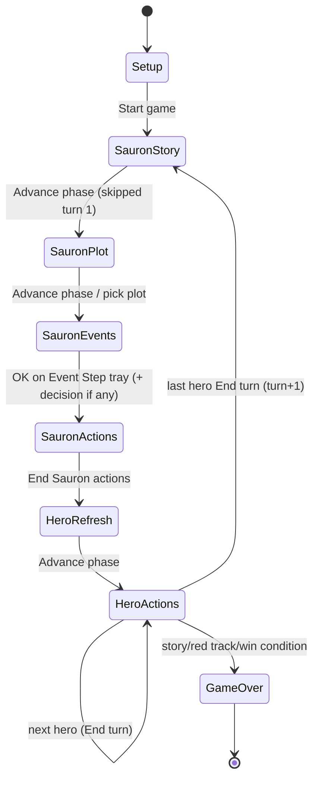
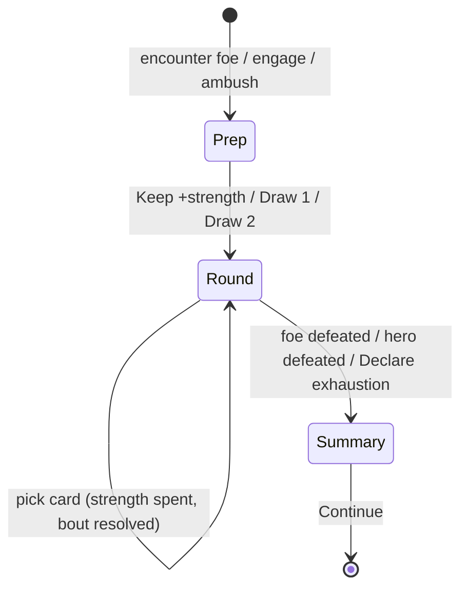

# MEQ — game state machine (abstract)

Cards are abstract; only stages, buttons and transitions are shown.
Engine phases: `HeroRefresh | HeroActions | SauronRefresh | SauronEvents | SauronMinions | StoryAdvance | GameOver`.

## Turn loop

Turn 1: Sauron plays first; Story and Plot are skipped, the Event step still happens.

## Hero turn (active hero)

| From | Button / click | Engine | To |
|---|---|---|---|
| Hero actions | Rest | `heroRest` (heal, once) | Hero actions (Rest disabled) |
| Hero actions | Map arrow → travel modal → pick cards → Travel | `heroMove` (discard matching terrain card or 2 any) | Hero actions; may trigger Ambush |
| Hero actions | Explore | `heroExplore` | Reveal tray |
| Hero actions | Consult (favor / ability) | favor spend or ability | Hero actions |
| Hero actions | Dark path | corruption alternative | Hero actions |
| Hero actions | Engage (danger) | `engage` | Combat prep |
| Hero actions | End turn | `endHeroActions` | next hero / Sauron |
| Reveal tray | OK (one applies) / click card (several) | `revealEncounter` | Encounter resolve |
| Reveal tray | OK (none applies) | resolve with no effect | Hero actions |
| Encounter resolve | option button | `chooseEncounterOption` | Encounter resolve / Training choice |
| Encounter resolve | Resolve encounter | `resolveEncounter` | Hero actions, or Combat |
| Training choice | pick one of two skill cards | `chooseTraining` | previous state |

## Combat

Per round: pick a card (or declare exhaustion). Effects carried to the next round are shown on each side; strength left is shown as a bar.
Outcome: foe removed if defeated (quest foes also removed on loss); hero damage may cause exhaustion/wounds.

## Sauron turn (human Sauron)

| Stage | Button | Result |
|---|---|---|
| Story | Advance phase | Story marker moves |
| Plot | Plot picker → choose | Plot placed |
| Events | Resolve events → OK | Event tray; tree decisions are Sauron/hero choices |
| Actions | Command / Place influence / Draw / Play shadow | Spend action; max 2 per turn (3 per rules variant) |
| Actions | End turn | Hero phase begins |
| Reaction | defender choice in combat / peril | Shadow card reaction |

## Known gaps

- "Each hero…" tree events resolve only for the first active hero (`runSauronEvents`).
- Sauron stage details above come from the engine source; no screenshot playthrough was run for Sauron yet.
